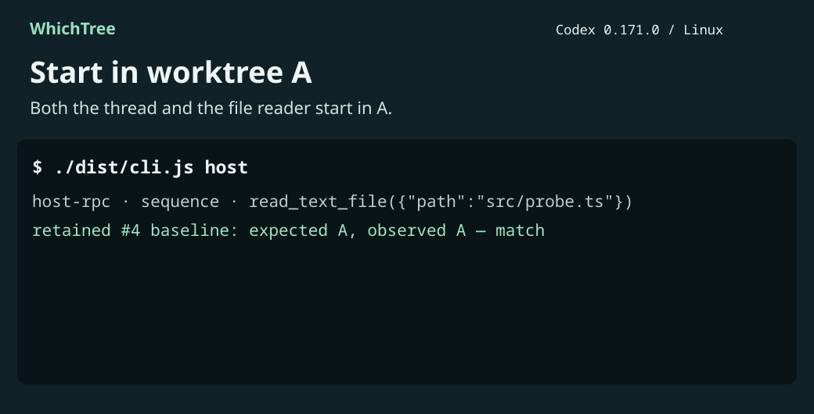

# WhichTree

See which Git checkout Codex's filesystem tool actually reads after a worktree switch. WhichTree asks for `src/probe.ts` in one live Codex app-server thread. A and B contain the same `witness` export with different random values. Only the returned file content identifies the checkout.

**[▶ Play the 20-second video with music](https://github.com/remnate/whichtree/blob/main/media/worktree-switch.mp4)** · [Inspect the call evidence](evidence/v0.1.0/host-sequence.json)

[](https://github.com/remnate/whichtree/blob/main/media/worktree-switch.mp4)

| Codex host RPC, Linux | Confirmed thread cwd | Registered server root | Returned |
|---|---|---|---|
| Start a thread in A | A | A | A · match |
| Switch that thread to B | B | A, deliberately stale | A · mismatch |
| Reload the registration in that thread | B | B | B · match |
| Launch a fresh host and thread in B | B | B | B · match |

These are measurements from WhichTree v0.1.0. The explicit A registration is a diagnostic control. The host driver calls the tool through RPC without a model turn. Server process identity across a switch and autonomous tool selection are outside this measurement. [Sanitized run with call IDs](evidence/v0.1.0/host-sequence.json)

## Run from a checkout

Use Linux, Git, Node 24 or later and npm. The host command also requires Codex CLI **0.171.0** on PATH. To select a separate installation, set `WHICHTREE_CODEX` to the absolute path to its executable. The fixture and SDK commands run independently of Codex. The host selector defaults to `--host codex`. An unsupported name produces an inconclusive result.

```sh
npm ci
npm run build
./dist/cli.js --help
./dist/cli.js host
```

The full host command exits **1** when it observes the deliberate mismatch. It continues through repair and cold launch. Each call uses exactly `read_text_file({"path":"src/probe.ts"})`. Output identifies the session, call ID and returned checkout. Each run creates fresh 128-bit markers inside two disposable linked Git worktrees, uses a private home and Codex registration, and cleans up the fixture.

## Example for an MCP integration maintainer

When investigating a suspected worktree handoff issue, first check whether the reader follows a single explicit root in a fresh process. Then exercise the host's directory update and reload sequence.

```sh
./dist/cli.js sdk cold             # New SDK client in B with server root B
./dist/cli.js sdk cold-stale       # New SDK client in B with server root A
./dist/cli.js host cold            # Independent Codex launch in B
./dist/cli.js host cold-stale      # Independent Codex launch with the fixed-A control
./dist/cli.js host --json > run.json
```

Read the observations in order. A returned A after a confirmed move to B identifies an actual content mismatch. A returned B after reload shows which registration served the repaired call. The query carries only the relative path. The tool sees a single allowed directory. The verifier compares the complete returned export to the markers from the active run.

| Command or result | Exit |
|---|---|
| Match | 0 |
| Mismatch, including an intentional control | 1 |
| Inconclusive, including unsupported host, unconfirmed transition, incomplete response or cleanup failure | 2 |
| `demo` | 0 only when both fixture assertions and cleanup pass |

For the offline fixture, run `./dist/cli.js demo`. For separate verdicts use `fixture cold` and `fixture cold-stale`. A multi-call run gives inconclusive precedence over mismatch, and mismatch precedence over match.

## Evidence and privacy

`--json` writes one sanitized report to stdout. Schema version 1 records the run ID, driver, runtime versions, requested relative path, host events, and per-call session alias, ID, scenario, expected/observed labels and verdict. Call IDs are scoped to a session. A missing observation during a failed transition leaves the overall status inconclusive. The driver checks raw host thread IDs locally before exporting aliases.

For local debugging, add `--private-trace NEW_FILE.jsonl` to capture the complete synthetic wire messages. WhichTree creates this file exclusively with mode 0600. It contains raw markers, thread IDs and absolute paths. Share the sanitized stdout report. v0.1 accepts live observations only. The synthetic setup uses local stdio and needs no model turn, login, external endpoint or changes to your account configuration.

## Measured compatibility

Recorded on Linux x64 with Node 24.14.0, npm 11.21.0 and Git 2.56.1. The installed filesystem server was 2.4.0. Each link opens output from the production-installed tarball, run in a network namespace with external networking disabled. Earlier engineering trials supplied the protocol recipe. The rows below come from this implementation.

| Driver | Runtime | Recorded run |
|---|---|---|
| host-rpc | Codex 0.171.0 | [Retained thread and fresh launch](evidence/v0.1.0/host-sequence.json) · [cold fixed-A control](evidence/v0.1.0/host-cold-stale.json) |
| sdk-real-server | JS SDK 1.32.2 | [Cold match](evidence/v0.1.0/sdk-cold.json) · [cold mismatch](evidence/v0.1.0/sdk-cold-stale.json) |
| fixture | Node filesystem | [Offline assertion suite](evidence/v0.1.0/demo.json) |

The SDK offers empty client capabilities and captures its MCP handshake and roots requests. Codex exposes server inventory and startup notifications. Its inner client capabilities, negotiated MCP protocol and roots exchange are marked unknown. Multiple allowed directories, client-provided roots, semantic indexes, other hosts, other Codex versions and macOS need independent runs. [Codex protocol reference](https://github.com/openai/codex/blob/rust-v0.171.0/codex-rs/app-server/README.md)

## Verify the package

```sh
npm test
npm run test:package
# On Linux with unprivileged user and network namespaces available:
npm run test:package -- --isolated-network
```

The package check installs the built tarball in an empty directory with production dependencies, checks the executable mode and invokes the installed bin for help, demo and a real SDK read. The namespace option disables networking for those installed commands after dependency installation.

[Contributing](CONTRIBUTING.md) · [Pilot and launch note](docs/launch.md) · [Third-party notices](NOTICE.md) · [MIT license](LICENSE)

